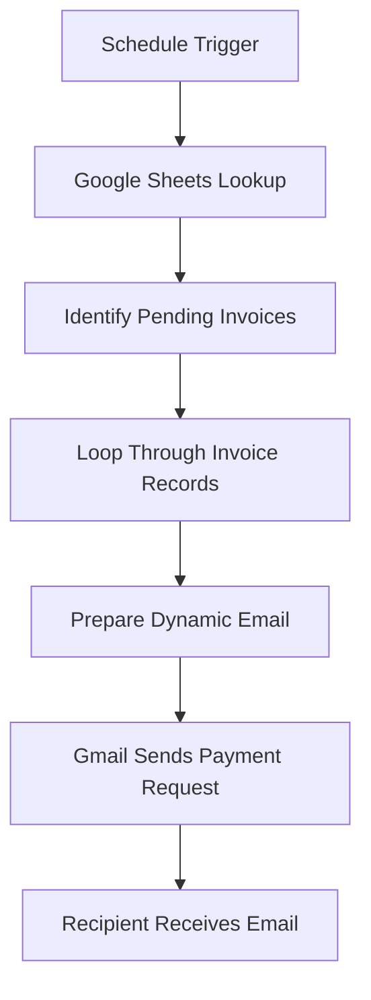
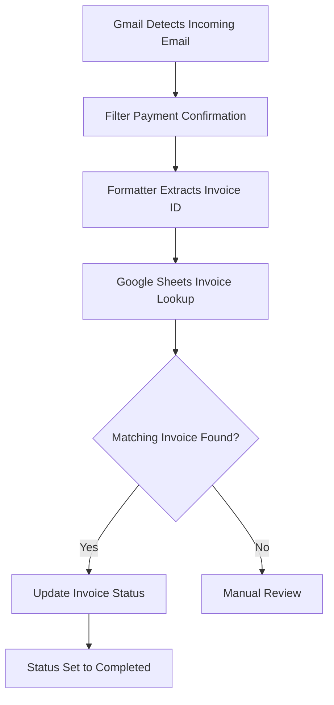

# Automated Invoice Payment Tracking Using Zapier

An automated invoice management system built using **Zapier, Google Sheets, and Gmail** to streamline payment reminders, process email-based payment confirmations, and maintain up-to-date invoice records.

## 1. Project Overview

This project implements an automated invoice payment tracking workflow using Zapier, Gmail, and Google Sheets. The system identifies invoices with pending payments, sends personalized payment request emails, captures payment confirmations through email replies, and updates the corresponding invoice status in Google Sheets.

The solution consists of two interconnected automation workflows, known as Zaps. The first Zap handles payment reminders, while the second processes payment confirmation emails and updates invoice records.

By connecting spreadsheet data with email communication, the system reduces repetitive administrative tasks and provides a centralized mechanism for monitoring invoice payment status.

## 2. Objectives

The primary objective of this project is to automate invoice payment follow-up and confirmation using a no-code workflow automation platform.

The key objectives are:

- Identify invoices whose payment status is `Pending`.
- Send automated and personalized payment request emails.
- Populate email templates dynamically using invoice information.
- Process multiple invoice records individually.
- Detect payment confirmation replies received through Gmail.
- Extract the relevant Invoice ID from incoming emails.
- Match the Invoice ID with the corresponding Google Sheets record.
- Automatically update the invoice status to `Completed` after valid payment confirmation.
- Reduce manual follow-up and improve payment tracking efficiency.

## 3. Tools and Technologies

| Tool / Technology | Purpose |
|---|---|
| **Zapier** | Connects applications and automates the workflow between them. |
| **Google Sheets** | Stores invoice records and maintains payment status information. |
| **Gmail** | Sends payment requests and receives payment confirmation replies. |
| **Formatter by Zapier** | Extracts or transforms information, such as Invoice IDs, from email data. |
| **Looping by Zapier** | Processes multiple invoice records individually within the reminder workflow. |
| **Filter by Zapier** | Applies conditions to determine whether a workflow should continue. |

## 4. Input Data

The invoice records are maintained in Google Sheets. Each row represents an invoice, and the columns contain the information required for payment follow-up and tracking.

| Field | Description |
|---|---|
| `Sr` | Serial number of the invoice record. |
| `Invoice ID` | Unique identifier used to locate the corresponding invoice. |
| `Type` | Category of the invoice, such as Project or Maintenance. |
| `Name` | Name associated with the invoice. |
| `Amount` | Outstanding invoice payment amount. |
| `Account No` | Bank account number associated with the payment. |
| `Bank Name` | Name of the bank associated with the account. |
| `Status` | Current payment status, such as Pending, Reminder Sent, or Completed. |

### Sample Invoice Data

| Sr | Invoice ID | Type | Name | Amount | Bank Name | Status |
|---:|---:|---|---|---:|---|---|
| 1 | 1001 | Maintenance | Madhav | 50000 | SBI | Pending |
| 2 | 1002 | Project | Ram | 28000 | ICICI | Pending |
| 3 | 1003 | Maintenance | Pavan | 94000 | HDFC | Pending |
| 4 | 1004 | Project | Raj | 80000 | Kotak | Completed |
| 5 | 1005 | Maintenance | Veeru | 85000 | DBS | Completed |

*Note: The records above are sample data used to illustrate the workflow. Account numbers have been omitted from this table for security.*

## 5. Workflow Architecture

The solution consists of two separate Zaps that work together to automate invoice payment tracking.

### Zap 1 — Automated Payment Request

**Purpose:** Identify pending invoices and send personalized payment request emails.

#### Workflow diagram



#### Workflow steps

1. **Schedule trigger:** Starts the workflow at a predefined time using Schedule by Zapier.
2. **Google Sheets lookup:** Retrieves invoice records whose status is `Pending`.
3. **Looping:** Processes the retrieved invoice records individually.
4. **Dynamic data mapping:** Inserts the relevant Invoice ID, name, type, amount, and banking details into the email template.
5. **Gmail action:** Sends the payment request to the appropriate recipient.
6. **Status management:** The workflow can update the record to `Reminder Sent` after the email is successfully sent, if this action is configured.

#### Payment request email

**Subject:** Payment Required – Invoice [Invoice ID]

```text
Dear Team,

A payment is pending for the following invoice:

Invoice ID: [Invoice ID]
Name: [Name]
Amount: ₹[Amount]

Please process the payment and confirm once the
payment has been completed.

To confirm the payment, please reply with:

Payment Done – Invoice ID: [Invoice ID]

Regards,
Accounts Team
```

The placeholders are replaced with values retrieved from the corresponding invoice record in Google Sheets.

**Reference:** [View Zap 1 – Payment Request Automation](https://zapier.com/templates/details/automate-payment-request-reminders-86dba6?secret=MTp0ZW1wbGF0ZTpja0FiQ2d6Q2Z5MFA0S1FsTVNZUkxzRENxa2puUFRLXzZXVURUUzBySFdROnVwMzJyNQ)

### Zap 2 — Automated Payment Confirmation

**Purpose:** Detect payment confirmation replies, identify the relevant invoice, and update its payment status.

#### Workflow diagram



#### Workflow steps

1. **Gmail trigger:** Detects incoming emails that may contain payment confirmations.
2. **Filter by Zapier:** Checks whether the email contains a configured payment confirmation phrase, such as `Payment Done`.
3. **Formatter by Zapier:** Extracts the Invoice ID from the email subject or message content.
4. **Google Sheets lookup:** Searches for the corresponding invoice using the extracted Invoice ID.
5. **Record matching:** Identifies the correct spreadsheet row before applying an update.
6. **Status update:** Changes the invoice status to `Completed` after the confirmation passes the configured checks.
7. **Exception handling:** Unmatched or ambiguous invoices should be left unchanged and flagged for manual review.

**Reference:** [View Zap 2 – Payment Confirmation Automation](https://zapier.com/templates/details/update-invoice-from-payment-confirmation-85b7dc?secret=MTp0ZW1wbGF0ZTpZa0pQSHVZelJUWWdhT25pN0dtNlh1ek9BSG1sWV9QYkVmLTZMTmZUaWhZOmFzNGJ4OQ)

## 6. Key Automation Features

### Automated Invoice Identification
The workflow retrieves invoices based on their payment status, reducing the need to search the spreadsheet manually.

### Personalized Email Communication
Dynamic field mapping allows the email template to include invoice-specific information, making each payment request relevant to the corresponding record.

### Individual Invoice Processing
Looping by Zapier supports processing multiple invoice records while maintaining the association between each invoice and its details.

### Conditional Workflow Execution
Filter by Zapier allows subsequent actions to run only when specified conditions are met, such as a valid payment confirmation being detected.

### Automated Invoice Matching
The extracted Invoice ID is used to locate the corresponding spreadsheet record, helping ensure that updates are applied to the correct invoice.

### Centralized Payment Tracking
Google Sheets acts as the central record of invoice information and payment status, providing a consolidated view of pending and completed payments.

### Reduced Manual Follow-up
Automating reminders and payment-status updates reduces repetitive administrative work and improves consistency.

## 7. Outcome

The project demonstrates an end-to-end invoice payment tracking process by integrating spreadsheet management, email communication, and conditional workflow automation.

The first Zap automates the identification of pending invoices and the sending of payment requests. The second Zap processes incoming payment confirmations, identifies the associated invoice, and updates its status in Google Sheets.

The solution illustrates how no-code automation can connect business applications to reduce repetitive manual tasks and improve operational efficiency.

The workflow can be extended with additional capabilities, including Transaction ID/UTR extraction, duplicate confirmation prevention, reminder escalation, and automated reconciliation reports.

## 8. Setup and Configuration

To recreate this project:

1. Prepare a Google Sheets spreadsheet containing the required invoice fields.
2. Connect Google Sheets and Gmail to Zapier.
3. Create the first Zap with a scheduled trigger.
4. Configure Google Sheets to retrieve pending invoice records.
5. Add Looping by Zapier to process each invoice individually.
6. Configure the Gmail payment request template using dynamic invoice fields.
7. Create a second Zap with Gmail as the incoming-email trigger.
8. Add a filter for payment confirmation messages.
9. Extract the Invoice ID using Formatter by Zapier.
10. Look up the matching invoice in Google Sheets.
11. Configure the update action to change the status to `Completed`.
12. Test both Zaps with sample data before activating them.

The exact actions and configuration options may vary depending on the connected applications and Zapier plan.

## 9. Testing and Validation

The automation should be tested with different invoice and email scenarios before it is activated.

| Test scenario | Expected result |
|---|---|
| Invoice status is Pending | Invoice is eligible for a reminder. |
| Invoice status is Completed | Invoice is excluded from reminders. |
| Multiple pending invoices exist | Each invoice is processed individually. |
| A valid payment confirmation is received | The confirmation workflow proceeds. |
| The Invoice ID matches a spreadsheet record | The corresponding record is selected. |
| The Invoice ID cannot be matched | No invoice is updated; manual review is required. |
| The confirmation message is ambiguous | The invoice remains unchanged. |

Testing should include checking the Zap execution history, the received Gmail messages, and the updated Google Sheets records.

## 10. Security Considerations

- Use sample banking details when demonstrating the workflow publicly.
- Do not commit passwords, API keys, or other confidential credentials to the repository.
- Use authorized Google account connections when integrating Gmail and Google Sheets.
- Validate invoice identifiers before updating records.
- Avoid modifying unrelated spreadsheet columns during status updates.
- Route ambiguous payment confirmations for manual verification.

## 11. Future Enhancements

The workflow can be extended with additional features:

- Extract and store Transaction ID/UTR from payment confirmation emails.
- Prevent duplicate processing of the same confirmation email.
- Send follow-up reminders for invoices that remain pending.
- Generate periodic payment tracking reports.
- Notify the accounts team about unmatched or ambiguous confirmations.
- Maintain a separate audit log of invoice status changes.

## Conclusion

The Automated Invoice Payment Tracking project demonstrates the practical application of no-code workflow automation in financial administration. By connecting Zapier, Google Sheets, and Gmail, the solution streamlines payment reminders, email-based confirmation processing, and invoice status management.

Its modular design separates reminder generation from payment reconciliation, making the workflow easier to test, maintain, and extend as additional requirements arise.
